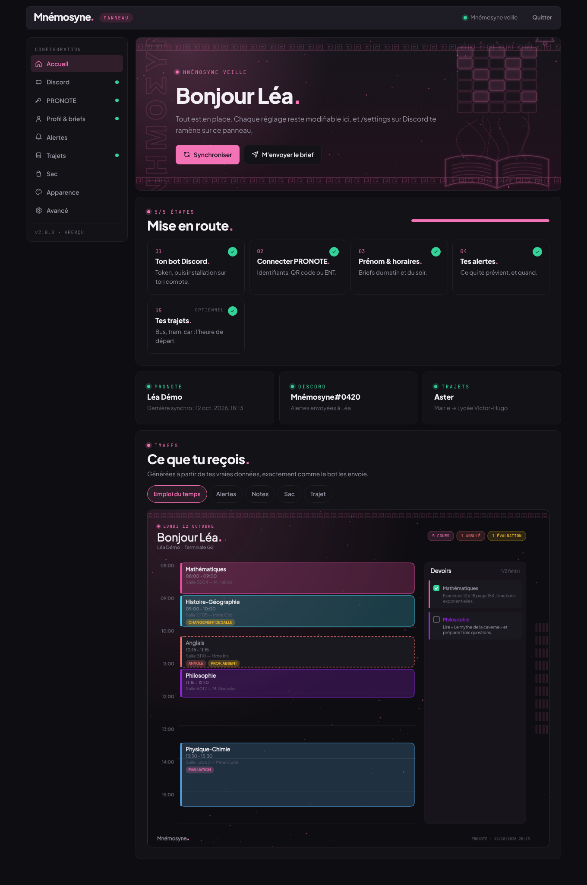
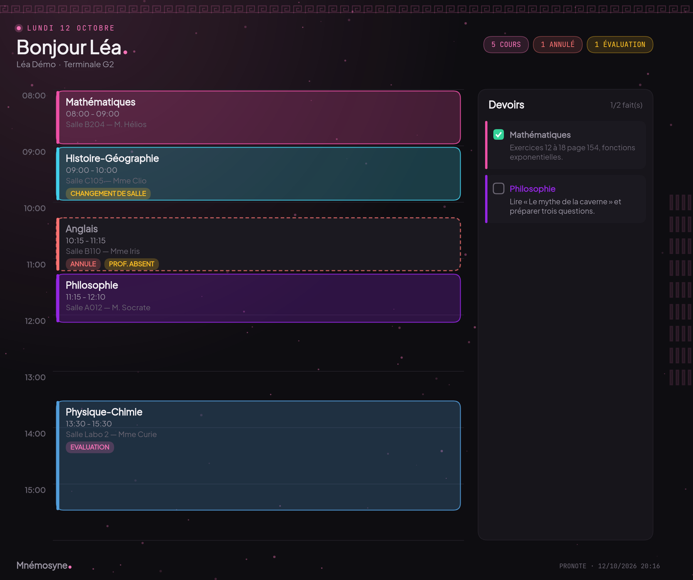
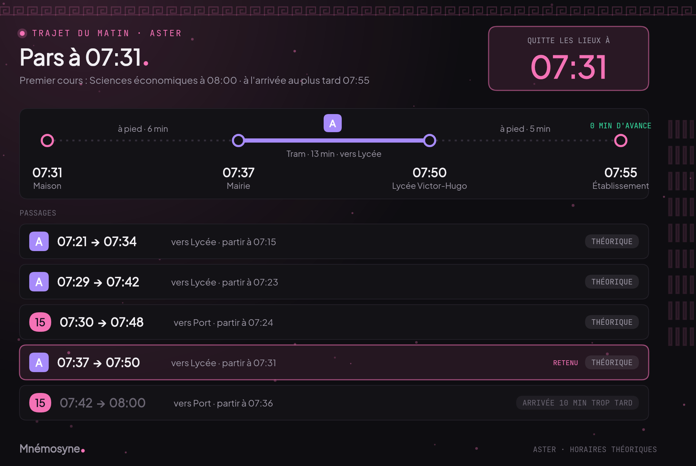
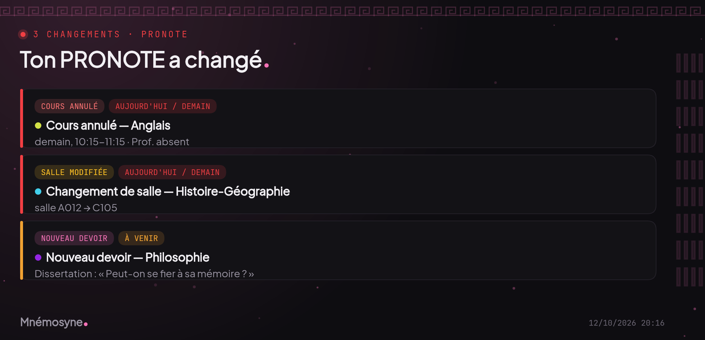
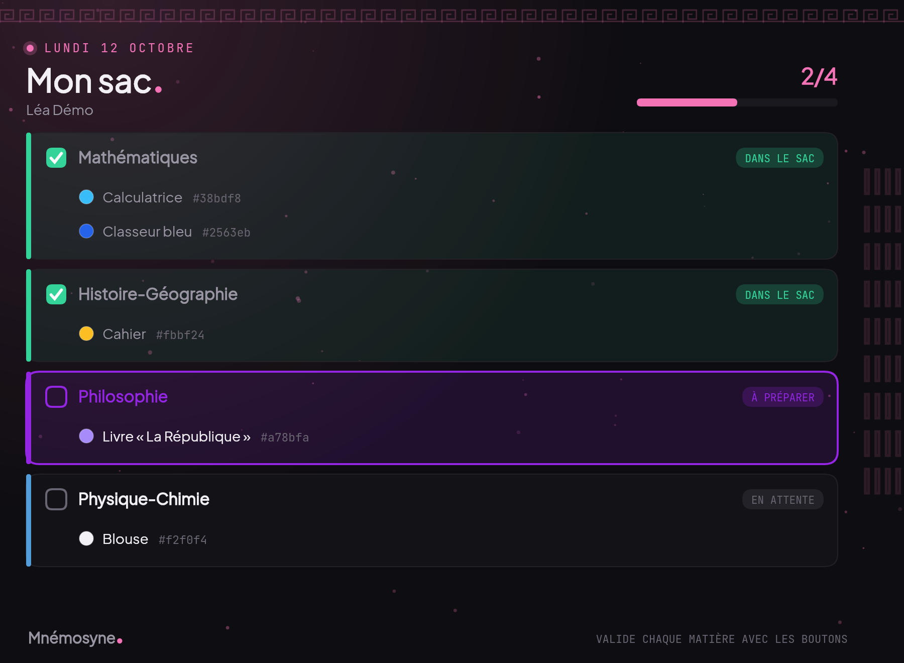
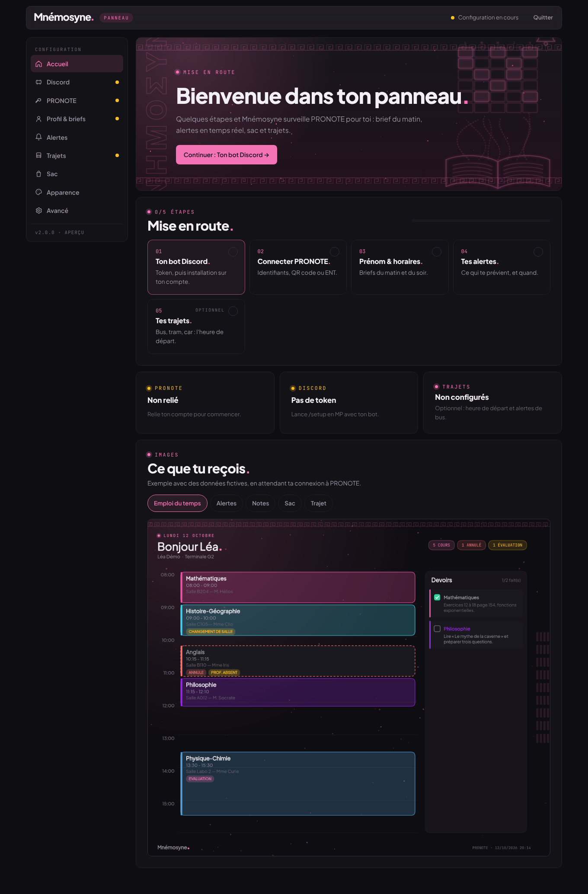
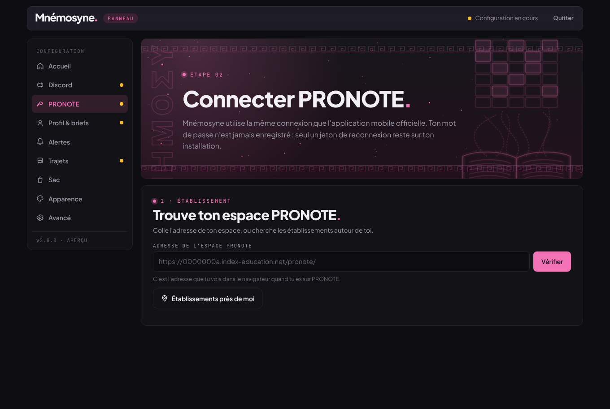
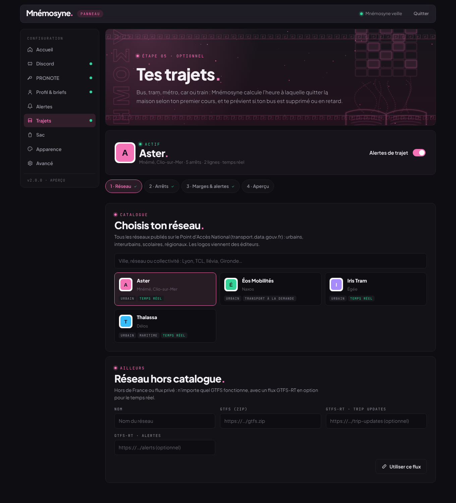
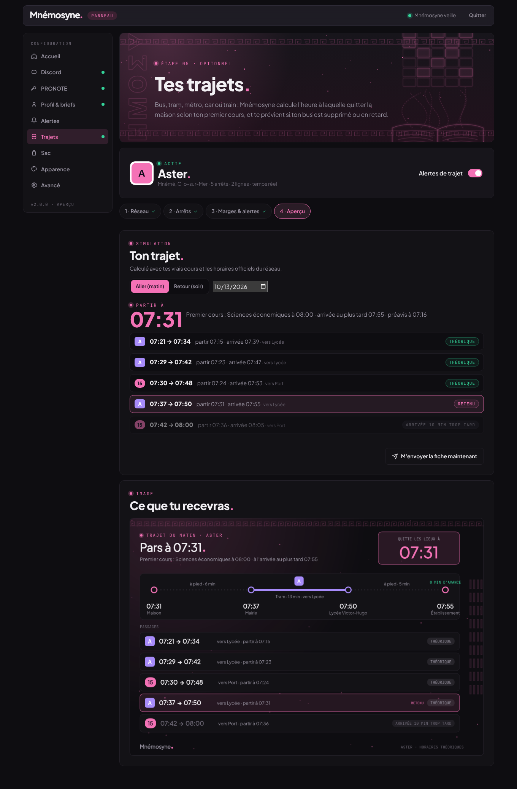

<p align="center">
  
</p>

<p align="center">
  <b>ΜΝΗΜΟΣΥΝΗ · la mémoire de l'élève</b><br>
  PRONOTE dans tes messages Discord : ta journée en une image chaque matin, une alerte dès que quelque chose change, ton sac prêt le soir, et l'heure exacte à laquelle partir pour ne pas rater ton bus.
</p>

<p align="center">
  
  
  
  
</p>

---

<p align="center"></p>

## Ce qu'elle fait

| | |
|---|---|
| **Le brief du matin** | À l'heure choisie, l'emploi du temps du jour en image : salles, profs absents, cours annulés, évaluations, devoirs à rendre. Le soir, celui du lendemain. |
| **Tout, en temps réel** | Une note, un devoir, une salle qui change, un cours annulé, un message : une alerte, une seule, au bon moment. La nuit, les alertes attendent ton réveil. |
| **Le sac du lendemain** | Ton matériel par matière, avec ses couleurs, validé matière par matière avec des boutons. |
| **L'heure de départ** | Bus, tram, métro, car, train : Mnémosyne calcule quand quitter la maison d'après ton premier cours et les horaires officiels, puis surveille ton bus (supprimé, en retard, en avance) et propose un plan B. |
| **Un panneau pour tout** | Connexion PRONOTE, réseau de transport, alertes, horaires, sac, thèmes, couleurs : tout se règle en ligne. `/settings` y ramène depuis Discord. |
| **En message privé** | Installé sur ton propre compte Discord, sans serveur : tout arrive dans ta conversation avec le bot. |

<table>
  <tr>
    <td></td>
    <td></td>
  </tr>
  <tr>
    <td></td>
    <td></td>
  </tr>
</table>

## Installation

Il faut **Node.js 20.11 ou plus récent**.

```bash
git clone https://github.com/SalksCore/Mn-mosyne.git mnemosyne
cd mnemosyne
npm install
npm start
```

La console affiche un lien personnel :

```
  ▸ Panneau Mnémosyne : http://localhost:8787/entrer/…
```

Ouvre-le : **toute la suite se fait dans le panneau**, étape par étape.

1. **Discord** : crée ton bot sur le [portail développeur](https://discord.com/developers/applications) (le panneau te guide), colle son token, puis « Ajouter à mon compte ». Les commandes sont publiées automatiquement.
2. **PRONOTE** : cherche ton établissement (adresse ou géolocalisation) puis connecte-toi par identifiants ou par **QR code** (capture d'écran, caméra ou texte). Le QR code fonctionne avec tous les ENT.
3. **Profil et briefs** : prénom, fuseau, heures du matin et du soir.
4. **Alertes** : ce qui te prévient, heures calmes, code couleur.
5. **Trajets** *(optionnel)* : choisis ton réseau parmi tous ceux de France, tes deux arrêts, tes temps de marche.

Ensuite, en message privé avec ton bot : **`/setup`**. C'est toi qui recevras les notifications.

> Le lien du panneau est valable 15 minutes et ne sert qu'une fois. Le navigateur reste ensuite connecté 30 jours. Pour revenir plus tard : **`/settings`** sur Discord.

### Sur un serveur

```bash
cp .env.example .env          # PUBLIC_URL=https://mnemo.exemple.fr
docker compose up -d --build
docker compose logs -f        # pour récupérer le lien du panneau
```

Les données vivent dans `./data`. Place le panneau derrière un proxy HTTPS (Caddy, Nginx, Traefik) si tu l'ouvres sur Internet.

### Sur Pterodactyl

Egg Node.js, fichier principal `index.js`, image Debian Node 22. Téléverse le zip, décompresse, démarre : le lien du panneau apparaît dans la console. Guide détaillé : [docs/PTERODACTYL.md](docs/PTERODACTYL.md).

### Variables d'environnement

Toutes sont facultatives : le panneau suffit.

| Variable | Rôle | Défaut |
|---|---|---|
| `DISCORD_TOKEN` | Token du bot. Sinon, à saisir dans le panneau. | — |
| `CLIENT_ID` | Identifiant de l'application, détecté depuis le token. | auto |
| `WEB_PORT` / `WEB_HOST` | Écoute du panneau (sinon `SERVER_PORT` de l'hébergeur). | `8787` / `0.0.0.0` |
| `PUBLIC_URL` | Adresse du panneau dans les liens envoyés sur Discord. | `http://localhost:8787` |
| `DATA_DIR` | Dossier des données. | `./data` |

## Le panneau

<table>
  <tr>
    <td></td>
    <td></td>
  </tr>
  <tr>
    <td></td>
    <td></td>
  </tr>
</table>

| Section | Réglages |
|---|---|
| **Accueil** | Avancement de la configuration, état de PRONOTE, de Discord et des trajets, aperçu de chaque image envoyée. |
| **Discord** | Token, installation sur ton compte, destinataire des alertes, guide de création du bot. |
| **PRONOTE** | Recherche d'établissement, connexion par identifiants ou QR code, double authentification (PIN, nouveau mot de passe), synchronisation, déliaison. |
| **Profil & briefs** | Prénom, fuseau horaire, briefs du matin et du soir, fréquence de vérification. |
| **Alertes** | Chaque catégorie activable, heures calmes, couleurs « aujourd'hui / demain » et « plus tard », alerte de test. |
| **Trajets** | Réseau (catalogue national ou GTFS personnalisé), arrêts (recherche ou « près de moi »), lignes autorisées, temps de marche, marge, préavis, seuil de retard, fiche de retour, info trafic, simulation jour par jour. |
| **Sac** | Matériel et couleur de chaque matière. |
| **Apparence** | Thème du panneau (nuit / jour), thème de chaque type d'image, couleur de chaque matière. |
| **Avancé** | Tests d'envoi, diagnostic, remise à zéro. |

## Commandes Discord

| Commande | Rôle |
|---|---|
| `/setup` | Première configuration : lien vers le panneau, et tu deviens destinataire des alertes. |
| `/settings` | Ouvre le panneau, où se trouvent **tous** les réglages. |
| `/brief` | Le récapitulatif de la journée, tout de suite. |
| `/edt jour` · `/edt semaine` | L'emploi du temps en image. |
| `/notes` | Le bulletin, par trimestre ou semestre. |
| `/devoirs` | Les devoirs à venir, filtrables. |
| `/sac voir · ajouter · retirer · preparer` | Le matériel, et sa préparation étape par étape. |
| `/transport maintenant · planb · info` | Prochain départ utile, itinéraires de repli, perturbations. |
| `/messages` · `/absences` · `/statut` · `/sync` | Le reste de PRONOTE. |
| `/config …` | Raccourcis : prénom, horaires, notifications, couleurs, thème. |

## Transports en commun

Mnémosyne ne contient **aucun code propre à un réseau**. Elle lit les standards ouverts :

- **GTFS** pour les horaires officiels, téléchargés une fois par semaine ;
- **GTFS-RT** pour les retards, suppressions et messages de perturbation, quand le réseau les publie.

Le catalogue vient du [Point d'Accès National](https://transport.data.gouv.fr) : tous les réseaux français qui publient un GTFS (urbains, interurbains, scolaires, régionaux, TER…) apparaissent dans le panneau avec leur logo. Hors de France, ou pour un flux privé, colle simplement l'adresse d'un GTFS et, en option, de ses flux GTFS-RT.

**Comment l'heure de départ est calculée.** Mnémosyne part du premier cours (moins ta marge et ta marche jusqu'à l'établissement) et remonte le temps : elle retient le **dernier** passage qui te fait arriver à l'heure. La durée du trajet est celle de la course elle-même, pas une estimation. Si le premier cours est annulé ou déplacé, le départ est recalculé à la synchronisation suivante.

## PRONOTE

Mnémosyne utilise [pawnote](https://github.com/LiterateInk/Pawnote.js) dans sa version maintenue **pawnote-lts**, la même bibliothèque que l'application Papillon, et se connecte comme l'application mobile officielle.

La version 2026 de PRONOTE a changé la connexion. Mnémosyne gère :

- le nouveau calcul du challenge d'authentification ;
- la vérification de l'identité de l'application sur chaque requête ;
- la **double authentification** imposée aux nouveaux appareils : nom d'appareil (automatique), code PIN, changement de mot de passe provisoire ;
- le nouveau format de la page d'accueil (2026.2) ;
- la mise en pause automatique de 30 minutes quand PRONOTE bloque l'adresse IP, pour ne pas prolonger le blocage.

Avec un **ENT** (EduConnect, Skolengo, Mon Bureau Numérique…), utilise le **QR code** : tu te connectes à PRONOTE comme d'habitude, PRONOTE génère le code, et Mnémosyne ne voit jamais tes identifiants ENT.

> PRONOTE n'a pas d'API publique : pawnote repose sur la rétro-ingénierie du protocole. Si PRONOTE change à nouveau, il faudra attendre une mise à jour de la bibliothèque.

## Les alertes

- **Une seule alerte par changement.** Un cours annulé donne un message, pas trois (« annulé », « statut modifié », « déplacé »).
- **Pas de fausse alerte.** Seule la période présente dans les deux synchronisations est comparée, et jamais le passé : plus de « cours retiré » en rafale le lundi. Une catégorie qui n'a pas pu être lue n'est pas comparée.
- **Jamais deux fois.** La déduplication repose sur l'état du cours, pas sur la formulation du message.
- **Groupées par urgence.** Aujourd'hui et demain en rouge, plus tard en ambre, notes et vie scolaire à part, messagerie dans des cartes dédiées.
- **Heures calmes.** La nuit, tout est mis de côté et arrive d'un bloc au réveil.
- **Premier passage silencieux.** Aucune avalanche à l'installation.

## Vie privée

Mnémosyne tourne chez toi. Ton mot de passe PRONOTE n'est jamais enregistré : seul un jeton de reconnexion est conservé. Configuration, jeton et dernier état de PRONOTE restent dans `data/`, sur ton installation. Le bot parle à PRONOTE, à Discord et, si tu actives les trajets, aux flux de ton réseau. Rien d'autre.

## Développement

```bash
npm run preview            # le panneau seul, avec des données fictives (sans Discord ni PRONOTE)
npm run preview -- --vide  # le parcours de première configuration
npm run samples            # régénère les images de docs/images
npm run typecheck
npm test
```

```
src/
├── index.ts             démarrage : panneau web, puis Discord dès qu'un token existe
├── pronote/             connexion (2026, double authentification), lecture, comparaison
├── notify/              alertes PRONOTE, heures calmes, briefs, sac
├── transport/           catalogue national, GTFS, GTFS-RT, calcul de trajet, alertes
├── render/              images (canvas) aux couleurs de Mnémosyne
├── commands/            commandes Discord
├── web/                 serveur du panneau, authentification, API
└── store/               données locales (écritures atomiques)
web/                     panneau : HTML, CSS, JS sans étape de build
```

Les contributions sont bienvenues : voir [CONTRIBUTING.md](CONTRIBUTING.md).

## Dépannage

| Symptôme | Piste |
|---|---|
| Lien du panneau expiré | `/settings` sur Discord, ou redémarre le bot pour en afficher un dans la console. |
| « Identifiant ou mot de passe incorrect » avec un ENT | Utilise le QR code. |
| PRONOTE demande un code PIN | Saisis-le dans la carte « Vérification » de la section PRONOTE. |
| « Adresse IP suspendue » | Patiente 30 minutes ; augmente l'intervalle de vérification (6 min ou plus). |
| Pas de notification | Vérifie que tu as lancé `/setup` en MP et que le bot est installé sur ton compte. |
| Commandes absentes | Elles sont publiées à la connexion du token ; la propagation peut prendre quelques minutes. |
| Aucun trajet trouvé | Les deux arrêts doivent être reliés par une ligne directe ; vérifie la section « Lignes ». |

## Licence

[MIT](LICENSE). Polices sous SIL Open Font License, lecteur de QR code [jsQR](https://github.com/cozmo/jsQR) sous Apache 2.0.

Mnémosyne n'est ni affiliée à Index Éducation, éditeur de PRONOTE, ni à Discord.
